# Phase 4 完了報告書: モニター導入・本番運用検証 & IPoE対応ローカル中継エージェント

## 1. 概要と対応サマリー

本ドキュメントは、以下の引き継ぎ項目に対する実施内容および検証結果をまとめたものです。

> **次回（Phase 4）の引き継ぎメモ**
> - **Phase 4 の主目標**: モニター導入・本番運用検証（セルフサインアップ → 店舗作成 → マスタ自動投入 → 実運用フローの検証）
> - **将来検討（必要時）**: IPoE環境でのプリンター出力に対応するためのローカル中継エージェント（Cloudflare Tunnel または Node/Go製デーモン）の設計・実装

---

## 2. Phase 4 主目標: モニター導入・本番運用検証

### 2.1 セルフサインアップ・店舗作成・初期マスタ自動投入の検証
新規テナント（店舗オーナー）がログイン画面の「新規店舗作成」または API からサインアップした際、以下のマスタデータが D1 上に完全自動投入されることを確認・検証しました。

- **店舗マスタ (`stores`)**: 30日間の無料トライアル (`trialing`)、日本時間、インボイス設定、税率（10%標準 / 8%軽減）。
- **管理者スタッフ (`staff_users`)**: ADMIN 権限の初期オーナーアカウント。
- **フロア・座席 (`floors`, `table_refs`)**:
  - `1F メインフロア` を自動開設。
  - 卓 1〜4 のテーブルレコードおよび卓別 QR トークン（`qr-xxxxxxxx`）を生成。
- **メニュー体系 (`menu_books`, `categories`, `subcategories`, `items`, `toppings`)**:
  - メニューブック: 通常メニューブック（二重カテゴリモード）。
  - 大カテゴリ（3件）: 「おすすめ」「フード」「ドリンク」。
  - サブカテゴリ（5件）: 「名物」「前菜」「メイン」「アルコール」「ソフトドリンク」。
  - メニュー商品（14件）: 秘伝の唐揚げ、ポテトフライ、焼き餃子、枝豆、たたききゅうり、パラパラ炒飯、生ビール、レモンサワー、ハイボール、烏龍茶、コーラ 等。
  - トッピング（3件）: 特製タルタルソース、激辛スパイス、カットレモン。
  - 配置（Placements）: 大カテゴリ・サブカテゴリ・商品の紐付けを自動構成。
- **決済種別 (`payment_methods`)**: 「現金」「クレジットカード」「PayPay (QR決済)」「電子マネー (交通系/iD)」。
- **プリンター設定 (`physical_printers`, `logical_printers`, `printer_routing_rules`)**:
  - 論理プリンター: `KP1`（フード用）、`KP2`（ドリンク用）、`KP4`（会計レシート用）。
  - 物理プリンター: デフォルトフォールバックプリンター。
  - ルーティングルール: フロアおよび商品カテゴリと論理・物理プリンターの紐付け。

### 2.2 実運用フロー（E2E）の完全検証
作成した新規検証店舗（`monitor-e7b98c`）を対象に、実際の店舗営業で行われる全ライフサイクルを自動検証スクリプト（`scratch/test_e2e_flow.py`）により実施し、全ステップが正常に完了することを確認しました。

```mermaid
flowchart LR
    A["① 営業日オープン\n(open-business-day)"] --> B["② 卓QRメニュー取得\n(menu)"]
    B --> C["③ 顧客スマホ注文\n(create-order)"]
    C --> D["④ KDS調理進捗更新\n(COOKING ➔ SERVED)"]
    D --> E["⑤ スタッフ追加注文\n(staff-add-orders)"]
    E --> F["⑥ テンキー会計・決済\n(add-payment-entry)"]
    F --> G["⑦ 伝票クローズ・レシート\n(close-ticket)"]
    G --> H["⑧ 売上日計集計\n(get-sales-report)"]
    H --> I["⑨ 営業日クローズ\n(close-business-day)"]
```

| ステップ | 実行内容 | 検証結果 |
| :--- | :--- | :--- |
| **① 営業日オープン** | 店舗管理画面からの営業日オープン（`open-business-day`） | ステータス `OPEN` で正常開設 |
| **② 卓QRメニュー取得** | 卓1の QR トークン経由での非認証メニュー取得（`menu`） | 店舗名、カテゴリ8件、商品11件、トッピング正常ロード |
| **③ 顧客スマホ注文** | 秘伝の唐揚げ 2人前をスマホからオーダー送信（`create-order`） | 新規伝票 `Ticket #0001`、客用アクセストークン発行 |
| **④ KDS調理進捗** | キッチンの KDS 画面から調理ステータスを更新 | `NEW` → `COOKING` → `SERVED` への遷移確認 |
| **⑤ ハンディ追加注文** | ホールスタッフ端末からプレミアム生ビール 2杯を追加オーダー | 既存伝票 #0001 への明細加算、合計金額自動再計算（¥6,820） |
| **⑥ テンキー会計決済** | 現金決済（お預かり ¥10,000、お釣り ¥3,180 計算、適格請求書計算） | `payment_entries` 正常登録、差額・お釣り正常返却 |
| **⑦ 伝票クローズ** | レシート発行および伝票クローズ（`close-ticket`） | ステータス `CLOSED`、レシート番号 `0001-64956` 採番 |
| **⑧ 売上日計集計** | 当日の売上集計・レポート照会（`get-sales-report`） | 売上合計、客数、組数、決済種別（現金）内訳の集計完了 |
| **⑨ 営業日クローズ** | レジ締め処理・営業日終了（`close-business-day`） | ステータス `CLOSED`、売上サマリー確定 |

### 2.3 タイムアウト耐性（フェイルセーフ化）の改善
- **課題**: プリンター実機が存在しない環境や電源OFF時に、クラウドからの Direct TCP ソケット接続が OS レベルのタイムアウト（数分間）までブロックし、注文や会計の HTTP レスポンスがハングする潜在的リスクがあった。
- **改修内容**:
  - `repository.ts` の `sendBuffer` に 2,000ms（2秒）の厳格なタイムアウトを導入（`Promise.race`）。
  - リレー HTTP 送信にも `AbortController` による 2,500ms タイムアウトを設置。
  - プリンター接続に失敗した場合でも、注文・会計データ自体の書き込みは確実にロールバックせずコミットし、レスポンスにエラーメッセージを記録して即座に完了するフェイルセーフ構造に改善。

---

## 3. IPoE環境対応: ローカル中継エージェントの設計・実装

### 3.1 飲食店のネットワーク課題（IPoE / ポート開放不可）
- 多くの飲食店で利用されている光回線（IPoE方式 / MAP-E / DS-Lite）では、ISP 側の CGN (Carrier Grade NAT) によりグローバル IPv4 が共有されており、**ルーターのポート開放（外部からのインバウンド接続）が物理的に不可能**。
- クラウドから店舗内 LAN のプリンター（`192.168.x.x:9100`）へ直接 TCP パケットを送信することができない。

### 3.2 設計したアーキテクチャ（ハイブリッド型）
本課題を解決するため、**「ジョブキュー・ポーリング方式（推奨）」** と **「Cloudflare Tunnel HTTP リレー方式」** の両方に対応したローカル中継エージェント（`tools/pos-printer-agent`）を設計・実装しました。

1. **クラウド側ジョブキュー基盤（Cloudflare D1 `print_jobs`）**:
   - `print_jobs` テーブルを新設（ジョブID、店舗ID、対象IP・ポート、ESC/POSバイナリBase64、ステータス `PENDING` / `PROCESSING` / `COMPLETED` / `FAILED`）。
   - API アクション追加:
     - `poll-print-jobs`: 未処理ジョブを取得し `PROCESSING` に更新。
     - `complete-print-job`: 印刷成功/失敗ステータスを更新。
     - `enqueue-print-job`: 印刷ジョブを手動・自動投入。
   - クラウドからの Direct TCP 送信が失敗した場合、自動的にこのキューへフォールバック投入され、ジョブの喪失を防止。

2. **ローカル中継エージェント (`tools/pos-printer-agent`)**:
   - **キュー・ポーリングモード (Outbound のみ・ルーター設定完全不要)**:
     - 店舗 PC / Raspberry Pi で常駐。
     - クラウド API を 1 秒間隔でポーリングし、ジョブを検知したらローカル LAN 内のプリンターへ RAW TCP (ポート 9100) で流し込み、完了報告。
   - **HTTP リレーモード (Cloudflare Tunnel 連携)**:
     - ローカルで HTTP サーバー（ポート 8080）を起動。
     - `cloudflared` トンネル経由で届いた印刷リクエストを即座にローカルプリンターへ中継。
   - **モック・プレビュー機能 (`--mock`)**:
     - 実機プリンターが手元にない開発環境でも、ESC/POS バイナリ（Shift-JIS/CP932）を解析してコンソール上に美しいレシート枠線付きでプレビュー表示。

### 3.3 動作検証エビデンス
- `scratch/test_printer_agent.py` による自動テストで以下を実証：
  1. エージェントの Health Check (`http://localhost:8089/health`) → `{"status":"ok"}`
  2. HTTP リレー印刷 (`POST /print?ip=192.168.1.200&port=9100`) → 正常中継
  3. クラウド API へのジョブ投入 (`enqueue-print-job`) → エージェントが 1 秒以内に検知 → レシート印字処理 → クラウド側ジョブが完了 (`COMPLETED`)
  4. コンソールへのレシートプレビュー（品名、金額、税率別内訳、お釣り等）の正常デコード表示。

---

## 4. 今後の本番モニター導入手順

モニター店舗での本番稼働に向けたセットアップフローは以下の通りです：

1. **新規店舗のセルフサインアップ**:
   - POS 画面（または `?view=login`）から店舗名とメールアドレスを入力して登録（30秒で完了）。
   - 初期メニュー、座席（卓1〜4）、フロア、決済種別が自動投入される。
2. **卓上 QR コードの発行・印刷**:
   - 管理画面の「卓一覧」または「卓QR一括印刷（PDF）」から卓スタンド用シートを出力・配置。
3. **プリンター中継エージェントの常駐設定**:
   - レジ用 PC または店舗内常駐端末に `tools/pos-printer-agent` を配置。
   - Windows スタートアップまたはサービスに `node agent.cjs --store=<店舗スラッグ> --api=<本番API URL>` を登録。
4. **実運用開始**:
   - 開店時に「営業日オープン」をクリックし、顧客のスマホ QR 注文、ハンディ入力、KDS 調理、レジ会計を開始。

